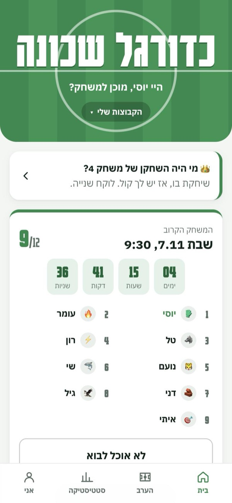
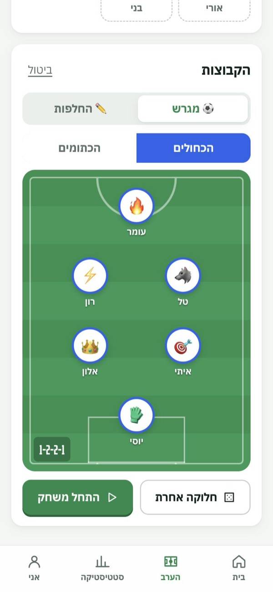
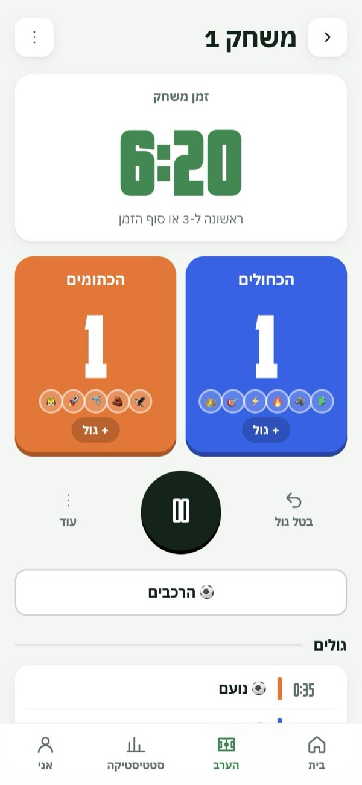
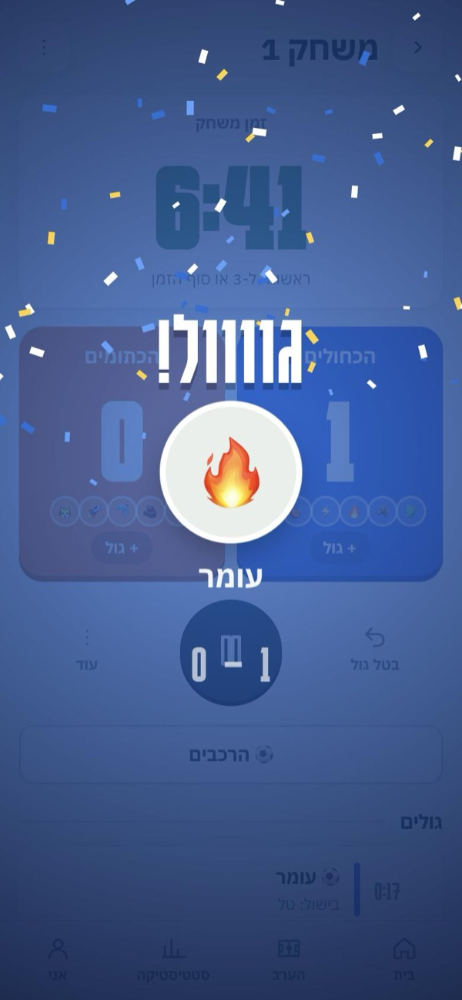
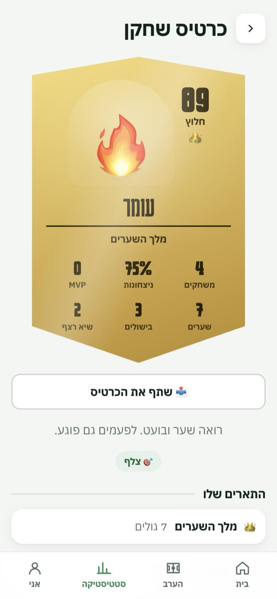

# ⚽ Neighborhood Football · כדורגל שכונה

A phone app for a weekly pickup football game: who's coming, fair teams, a live match clock,
and a ranking the players make themselves. Built for one Saturday-morning game in Israel,
now open to any group. The app is in Hebrew (right-to-left).

**Live:** https://neighborhood-football.vercel.app

| Next game | Fair teams | Live match | Goal! | Player card |
|:-:|:-:|:-:|:-:|:-:|
|  |  |  |  |  |

<sub>Screenshots from the built-in demo, with made-up players.</sub>

## What it does

- **Groups without accounts.** Anyone can open a group (name, day, time, place, rules) and becomes
  its admin. Friends join with the group's code. Each player gets a personal link, so there are
  no passwords and no sign-ups.
- **Signups.** "I'm coming" for the next game, with a countdown to kickoff. The list from WhatsApp
  can be pasted in, and the app matches the names.
- **Fair teams.** Teams are made from the players' ratings and positions (each player can play
  several). The lineup is drawn on a pitch, and extra players rotate in.
- **Live match.** Clock, score and scorers, with the group's rules: minutes per game, first to N
  goals, extra time, then golden goal. Every phone updates live, with whistles, a crowd roar
  and confetti on goals.
- **Ranking.** Players drag their teammates into order. The admin can see who really ranked
  and who just pressed save. Ballots left untouched don't count.
- **Player cards.** Football-card style cards with a photo, position and stats, shareable as an image.
- **Installable.** It's a PWA, so it can go on the home screen and updates itself.

## Tech

- [Vite](https://vite.dev) + React 19, with no UI framework (plain CSS in `src/styles.css`)
- [Supabase](https://supabase.com) (Postgres): all permissions live in the database, as row-level
  security and functions that check a personal code sent with each request. There is no
  backend server.
- [vite-plugin-pwa](https://vite-pwa-org.netlify.app) to install it and update it automatically
- Tests: Node's built-in test runner, plus [PGlite](https://pglite.dev) to run the real
  database schema in memory

## Run it

```bash
npm install
npm run dev
```

Without Supabase keys, the app runs in **demo mode**: everything is saved in your browser only,
which is handy for trying it out.

To connect a real database, copy `.env.example` to `.env.local` and fill in the project URL
and the **publishable** key. Then run `supabase/schema.sql` once in the Supabase SQL editor.
Step-by-step instructions, in Hebrew: [SETUP.md](SETUP.md).

```bash
npm test         # 148 tests: app logic and the database schema
npm run build    # production build into dist/
```

## Project layout

```
src/
  screens/     one file per screen (Home, Tonight, Match, Vote, Me, admin/…)
  components/  shared pieces (Lineup, Celebration, SignupCard, …)
  lib/         logic without UI: teams, clock, rating, sounds, photos
  data/        supabaseApi.js (live) and mockApi.js (demo), with the same functions
  sports/      what is football-specific, so other sports can be added later
supabase/
  schema.sql   the whole database; safe to run again on an existing one
tests/
docs/
  contract.md  how the app and the database talk to each other
  sports.md    how to add another sport
```

## Credits

The goal sounds are CC0 recordings from Freesound; see
[public/sounds/CREDITS.md](public/sounds/CREDITS.md).
